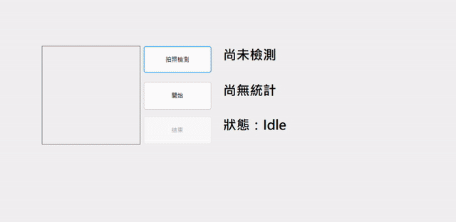

# Mini AOI Simulator

以 C# 與 WinForms 實作的迷你自動光學檢測（AOI, Automated Optical Inspection）機台模擬器。模擬相機持續產生帶有瑕疵的影像，系統在背景執行緒自動檢測並判定 OK / NG，即時更新畫面與良率統計，並將 NG 結果寫入記錄檔。

本專案用於練習物件導向設計、事件驅動架構與多執行緒程式設計，並模擬實際機台軟體的分層架構。



## 功能

- **模擬取像**：程式自動產生灰階影像，依設定機率隨機加入黑點或刮痕瑕疵
- **瑕疵檢測**：以二值化方法統計暗像素數量，超過門檻判定為 NG
- **單次檢測與連續運轉**：可手動拍照檢測，或啟動機台每 0.5 秒自動檢測
- **即時統計**：顯示檢測總數、NG 數與良率
- **NG 記錄**：NG 結果附時間戳記寫入 `ng_log.txt`
- **機台狀態管理**：Idle / Running / Error 狀態切換，背景發生例外時自動切換至 Error

## 架構

```
AoiSimulator/
├── Models/
│   └── InspectionResult.cs     檢測結果資料模型、Verdict 與 MachineState 列舉
├── Devices/
│   ├── ICamera.cs              相機介面
│   └── SimulatedCamera.cs      模擬相機實作
├── Inspection/
│   ├── IInspector.cs           檢測器介面
│   └── ThresholdInspector.cs   二值化檢測器
├── Core/
│   ├── InspectionStation.cs    檢測站：串接相機與檢測器，管理運轉迴圈、統計與事件
│   └── NgLogger.cs             NG 記錄器：訂閱檢測完成事件
└── Form1.cs                    人機介面
```

### 運作流程

```
開始 → InspectionStation（背景執行緒）
          │
          ├─ ICamera.Capture()       取像
          ├─ IInspector.Inspect()    檢測
          ├─ 更新統計
          └─ InspectionCompleted 事件
                 ├─ Form1     → BeginInvoke 回 UI 執行緒更新畫面
                 └─ NgLogger  → NG 時寫入記錄檔
```

## 設計重點

**介面與多型**
相機與檢測器皆透過介面（`ICamera`、`IInspector`）使用。更換相機廠牌或檢測演算法時，只需新增實作類別，主程式不需修改；沒有實體相機時也能以模擬相機開發與測試。

**依賴注入**
`InspectionStation` 不自行建立相機與檢測器，而是由建構子傳入，降低類別之間的耦合。

**事件驅動**
檢測站完成檢測後只發出 `InspectionCompleted` 事件，不需知道有哪些訂閱者。新增 NG 記錄功能時只需新增訂閱者，檢測站完全不用修改（開放封閉原則）。

**封裝**
統計數據使用 `{ get; private set; }`，外部只能讀取，只有檢測站本身能更新。

**多執行緒與 UI 更新**
- 連續檢測迴圈以 `Task.Run` 在背景執行，避免畫面凍結
- 以 `CancellationToken` 安全停止背景工作，不強制中斷執行緒
- WinForms 控制項只能由 UI 執行緒修改，事件處理中以 `InvokeRequired` 與 `BeginInvoke` 將畫面更新交回 UI 執行緒
- 背景工作以 try/catch 捕捉例外並切換至 Error 狀態，避免例外被 Task 默默吞掉
- 關閉視窗前先停止機台，避免背景執行緒存取已釋放的控制項

## 執行方式

**環境需求**
- Windows
- Visual Studio 2022（需安裝「.NET 桌面開發」工作負載）
- .NET 8 SDK

**步驟**
1. 以 Visual Studio 開啟 `AoiSimulator.sln`
2. 按 `F5` 建置並執行
3. 「拍照檢測」執行單次檢測；「開始」啟動連續檢測；「結束」停止運轉

NG 記錄檔位於執行檔所在資料夾（`bin/Debug/net8.0-windows/ng_log.txt`）。

## 未來改進

- 以 `LockBits` 取代 `GetPixel` 直接存取影像記憶體，加速檢測
- 新增以連通元件分析計算缺陷數量與面積的 `BlobInspector`，並可於介面切換檢測器
- 新增 Paused 狀態，支援暫停與繼續運轉
- 加入深度學習瑕疵檢測模型（例如以 ONNX Runtime 進行推論）
